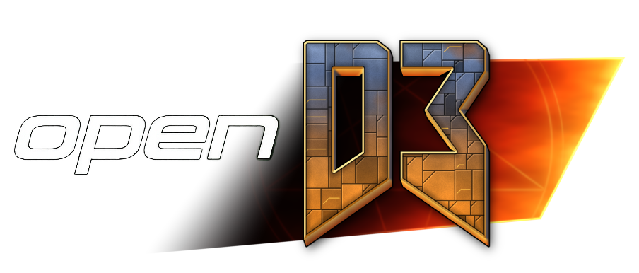

**DOOM 3 on a modern open-source engine.** 
A GPL engine and game-code replacement that runs the original 2004 game from your own retail files.

[Quick start](#quick-start) · [Features](#features) · [Platforms](#platforms-and-requirements) · [Guides](#player-guides) · [Help](#getting-help) · [Build from source](BUILDING.md)

## What is openD3?

openD3 replaces Doom 3's engine and game binaries with its own, built from id Software's GPL source on top of the [openQ4](https://github.com/themuffinator/openQ4) engine. The campaign and multiplayer maps load from your retail game files, with openQ4's window handling and a choice of OpenGL or Vulkan rendering.

> [!NOTE]
> openD3 does **not** include any Doom 3 game data. You need your own copy of Doom 3 (2004). Doom 3: BFG Edition's data is a different format and is not supported.

> [!IMPORTANT]
> openD3 is in **early development** and has no release. It has just moved onto the current openQ4 engine, and so far only the first campaign map and a dedicated-server start have been run on it. Read [Features](#features) before expecting to play through the game.

## Quick start

There is no release yet, so you build openD3 yourself:

1. Install **Doom 3**. Leave it where it is; openD3 keeps to its own folder.
2. Build and stage openD3 with [BUILDING.md](BUILDING.md). The staged package lands in `.install/`.
3. Launch `openD3-client_x64` (`.exe` on Windows) from `.install/` with `+set ui_retained 0`.
4. openD3 finds your Doom 3 install on its own. If it doesn't, see [If auto-detection fails](docs/user/getting-started.md#if-auto-detection-fails).

> [!TIP]
> Don't copy retail `.pk4` files into `baseod3/`. That folder is for openD3's own files.

Updating? Rebuild and stage the whole package rather than single files, and expect saves from an older build not to load. [Getting Started](docs/user/getting-started.md#updating-opend3) explains why.

## Features

What has been run so far, on Windows x64 against the Steam release of Doom 3:

- 💿 **Finds and checks your game files.** Startup locates the install, verifies `pak000`–`pak004` by checksum and ignores the retail game binaries.
- 🗺️ **Loads the campaign's first map.** `game/mars_city1` loads, plays its opening cinematic with working in-world screens, and autosaves.
- 🎨 **OpenGL and Vulkan.** The same map renders on the default OpenGL renderer and on the native Vulkan renderer (`+set r_renderApi vulkan`).
- 📺 **Doom 3's own menus.** The original main menu starts and plays the intro video.
- 🖥️ **Dedicated server.** `openD3-ded_x64` starts a deathmatch map; see [Server Setup](docs/user/server-setup.md).

Not yet checked, so don't rely on it: playing beyond the first cinematic, loading saves, level changes, a client joining a multiplayer server, and every platform other than Windows x64.

Not working yet:

- **Resurrection of Evil.** `+set fs_game d3xp` loads the expansion's game module, but no expansion map has been run yet. See [Campaigns](docs/user/campaigns.md#resurrection-of-evil).
- **openQ4's retained menus and HUD.** They have no Doom 3 pages; openD3 uses Doom 3's own menus, which is why you launch with `ui_retained 0`.

[Release status](docs/user/release-status.md) puts this in player terms. The [rebase record](docs/dev/doom3-rebase.md) is the detailed and current statement of what has been verified and what is open.

## Platforms and requirements

Only Windows x64 has been built and run. The openQ4 engine underneath also supports Linux, Steam Deck, macOS and Android, but openD3 has not been tried on any of them.

| Platform | Package | Notes |
|---|---|---|
| **Windows x64** | Build from source | Builds and runs; all testing so far |
| **Linux x64, Linux ARM64, Steam Deck** | None | Not built or run for openD3 |
| **macOS** | None | Not built or run for openD3 |
| **Android** | None | Not built or run for openD3 |

| | Needed |
|---|---|
| **CPU** | 64-bit x64 |
| **Graphics** | An OpenGL driver with ARB vertex and fragment program support, or a Vulkan 1.3 driver for the Vulkan renderer |
| **Storage** | About 1.5 GB for Doom 3's `base/` files, plus the openD3 build |
| **Game data** | Doom 3's retail `base/` packs at version 1.3.1 |

No memory or performance minimums have been measured yet. Details are in [Getting Started](docs/user/getting-started.md#system-requirements).

## Player guides

These guides follow the current source tree. Start with [release status](docs/user/release-status.md) for what has been run and what has not.

**Set up**
- [Getting Started](docs/user/getting-started.md): what you need, first launch and where your files go
- [Client Settings](docs/user/client-settings.md): launch options, the renderer choice and where settings are saved

**Play**
- [Campaigns](docs/user/campaigns.md): starting Doom 3's levels, and the state of Resurrection of Evil

**Look and feel**
- The renderer and display features inherited from openQ4 (shadow maps, light grids, post-processing, presets, controller support) are described in [openQ4's guides](https://github.com/themuffinator/openQ4/tree/main/docs/user). None has been checked with Doom 3 yet.

**Host and create**
- [Server Setup](docs/user/server-setup.md): starting a dedicated server (startup only has been run)
- [Mods](TECHNICAL.md#mods): what a mod folder needs

## Compatibility

- openD3 runs the **official retail Doom 3 assets** with its **own engine and game modules**.
- Mods that ship their own game DLL built for the original `gamex86` interface won't load. Content-only mods need a `mod.json`; see [TECHNICAL.md](TECHNICAL.md#mods).
- Retail Doom 3 clients and servers are not expected to join openD3 games, or the other way round, and nothing of the kind has been tried. Use matching openD3 builds on every client and server.
- openD3 is in **early development**: most of the game has not been run yet.

## Getting help

- **Something broken?** Open an [issue](https://github.com/themuffinator/openD3/issues) with your setup and a log: launch with `+set logFile 2`, reproduce the problem and attach the log from your save folder.
- **Crashed on Windows?** Attach the log and minidump from the `crashes/` folder beside the executable.
- **Want to chat?** Find us on the [DarkMatter Discord](https://discord.gg/T32mFejwR4).

## For developers

- [BUILDING.md](BUILDING.md): build and stage openD3
- [TECHNICAL.md](TECHNICAL.md): layout, modules, configuration and dependencies
- [AGENTS.md](AGENTS.md): project rules and the debug loop
- [The rebase record](docs/dev/doom3-rebase.md): how openD3 moved onto openQ4, the engine/game contract and the open items
- [Game source provenance](docs/dev/game-source-provenance.md): where the game library came from

## Credits

**themuffinator** leads openD3's development, with stewardship from **DarkMatter Productions**. openD3 stands on **id Software**'s Doom 3 and its GPL source release, and on the **[openQ4](https://github.com/themuffinator/openQ4)** engine, which brings the work of everyone credited there with it.

<b>Full credits and third-party software</b>

- **themuffinator**: openD3 development and maintenance; author of openQ4 and openPREY
- **DarkMatter Productions**: project stewardship and [website](https://www.darkmatter-quake.com)
- **id Software**: Doom 3, Resurrection of Evil (with **Nerve Software**) and the GPL source release openD3's game modules are built from
- **[openQ4](https://github.com/themuffinator/openQ4)**: the engine openD3 is built on; its history is merged into this repository
- **[openPREY](https://github.com/themuffinator/openPREY)**: source of the Doom 3-lineage engine layer (particle and FX declarations, Doom 3 map formats, game API bridging) that openD3 adapted
- **[Emile Belanger (emileb)](https://github.com/emileb)**: original author of the Android port, SigmaTouch integration, OpenGL ES 3.0 renderer and GLES shader variants carried with the openQ4 engine; see [CONTRIBUTORS.md](CONTRIBUTORS.md)
- **Justin Marshall**: Quake4Doom, the base of the openQ4 engine
- **Daniel Gibson and the [dhewm3](https://github.com/dhewm/dhewm3) contributors**: behaviour reference for Doom 3 compatibility, and code inherited through Quake4Doom and openQ4
- **Robert Beckebans**: renderer modernisation reference work, including RBDOOM-3-BFG
- **Raven Software**: the Quake 4 engine lineage behind openQ4
- **[Ronald Rivest and RSA Data Security, Inc.](https://www.rfc-editor.org/rfc/rfc1320)**: the MD4 Message-Digest Algorithm behind the PK4 checksums; [notice](LICENSES/MD4.txt)
- **[The RmlUi Team and contributors](https://github.com/mikke89/RmlUi/tree/6.3)**: MIT-licensed layout library behind the engine's retained interface; [notice](LICENSES/RmlUi.txt)
- **[The JsonCpp authors](https://github.com/open-source-parsers/jsoncpp/tree/1.9.8)**: JSON parser, used under its MIT option; [notice](LICENSES/JsonCpp.txt)
- **[Mikko Mononen, Eric Veach and the libtess2 contributors](https://github.com/memononen/libtess2)**: SGI-B-2.0 polygon tessellator; [notice](LICENSES/libtess2.txt)
- **Sam Lantinga and the [SDL contributors](https://github.com/libsdl-org/SDL)**: window, display and input support
- **Chris Robinson and the [OpenAL Soft](https://openal-soft.org/) contributors**: the OpenAL runtime
- **[Xiph.Org Foundation](https://xiph.org/vorbis/)**: libogg and libvorbis
- **Sean Barrett and the [stb_vorbis contributors](https://github.com/nothings/stb)**: Vorbis decoding
- **The [GLEW](https://github.com/nigels-com/glew) team**: OpenGL extension loading
- **The Khronos Group and contributors**: [glslang](LICENSES/glslang.txt), the [OpenXR loader](LICENSES/openxr-sdk.txt) and the [OpenGL ES headers](LICENSES/KHRONOS-GLES-MIT.txt)

## Licence

openD3, engine and game code alike, is licensed under the [GNU General Public License v3.0](LICENSE). Files that keep Doom 3 or Doom 3 BFG Edition headers also keep their upstream notices and [Additional](LICENSES/DOOM-3-ADDITIONAL-TERMS.txt) [Terms](LICENSES/DOOM-3-BFG-ADDITIONAL-TERMS.txt). [LICENSING.md](LICENSING.md) covers each component, including third-party libraries.

Doom 3's game assets remain the property of their rights holders and are not included. openD3 is an independent project and is not affiliated with, endorsed by or sponsored by id Software, Bethesda or ZeniMax Media. DOOM is a trademark of ZeniMax Media Inc.

---

  <a href="https://www.darkmatter-quake.com">Website</a> · <a href="https://github.com/themuffinator/openD3/issues">Issues</a> · <a href="https://discord.gg/T32mFejwR4">Discord</a> · <a href="#top">Back to top</a>

