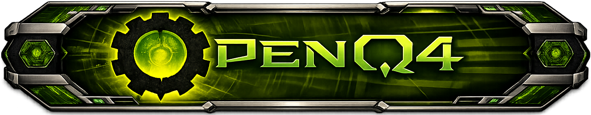

<div align="center">



[](https://www.gnu.org/licenses/gpl-3.0)
[](https://github.com/themuffinator/OpenD3)
[](https://github.com/themuffinator/OpenD3)
[](https://github.com/themuffinator/OpenD3)
[](https://mesonbuild.com/)

**OpenD3: minimal Doom 3 adaptation of the OpenQ4-era codebase**

</div>

## About

OpenD3 is a transitional branch that rebrands and retargets this repository toward Doom 3 compatibility.

Current priorities:
- Reinstate Doom 3 compatibility with stock assets.
- Keep the codebase open-source end-to-end.
- Remove dependency on Quake 4 legacy external effects companion-repo build paths.
- Keep modernization work on SDL3 + Meson.

This project does not ship copyrighted game assets. You must own a legitimate copy of Doom 3.

## Companion Repositories

- Game libraries (canonical source): `../OpenD3-GameLibs`
- Doom 3 behavior/reference baseline (local): `E:\_SOURCE\_CODE\dhewm3-master`

For game-library changes, edit `OpenD3-GameLibs` first, then sync with:

```powershell
powershell -ExecutionPolicy Bypass -File tools/build/sync_gamelibs.ps1
```

## Build Quick Start (Windows)

```powershell
# Configure
powershell -ExecutionPolicy Bypass -File tools/build/meson_setup.ps1 setup --wipe builddir . --backend ninja --buildtype debug --wrap-mode=forcefallback

# Compile
powershell -ExecutionPolicy Bypass -File tools/build/meson_setup.ps1 compile -C builddir

# Stage install tree
powershell -ExecutionPolicy Bypass -File tools/build/meson_setup.ps1 install -C builddir --no-rebuild --skip-subprojects
```

Executable outputs:
- `builddir/OpenD3-client_x64.exe`
- `builddir/OpenD3-ded_x64.exe`
- `.install/OpenD3-client_x64.exe`
- `.install/OpenD3-ded_x64.exe`

## Environment Variables

- `OPEND3_GAMELIBS_REPO=<path>`: override companion game-libs repo location.
- `OPEND3_SKIP_GAMELIBS_SYNC=1`: skip automatic game-libs sync in Meson wrapper.
- `OPEND3_BUILD_GAMELIBS=1`: trigger companion game-libs build during `compile` (auto-skips when the companion repo is source-only and has no standalone build wrapper).
- `OPEND3_SKIP_GAMELIBS_BUILD=1`: skip optional companion build trigger.

Note: legacy `OPENQ4_*` env vars may still be accepted temporarily for migration compatibility.

## Runtime Notes

- Staging root: `.install/`
- Active game staging dir currently: `.install/openbase/` (transitional layout)
- VS Code launch defaults use Doom 3 install path:
  - `C:\Program Files (x86)\Steam\steamapps\common\Doom 3`

## Documentation

- `AGENTS.md` - project rules and agent workflow
- `docs-dev/doom3-compatibility-reversion.md` - what to compare/revert against dhewm3
- `docs-dev/platform-support.md` - platform and architecture roadmap
- `docs-dev/input-key-matrix.md` - SDL3 input parity notes
- `docs-dev/release-completion.md` - migration/release tracking
- `docs-dev/official-pk4-checksums.md` - Doom 3 pk4 validation notes
- `docs-user/display-settings.md` - display/window configuration
- `TODO.md` - near-term task list

## Credits

- themuffinator
- id Software
- Raven Software
- Justin Marshall
- Robert Backebans

## License

OpenD3 engine-side source is licensed under GPLv3 (`LICENSE`).

You must own legitimate Doom 3 assets to run this project.
